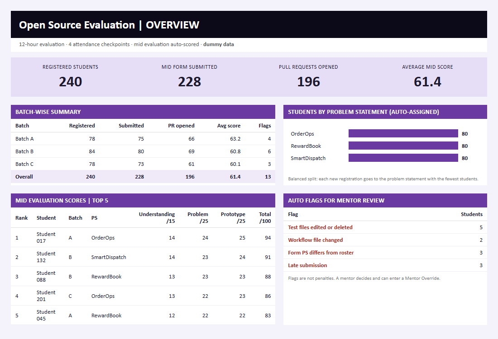
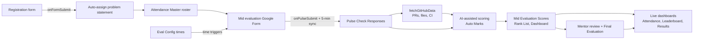
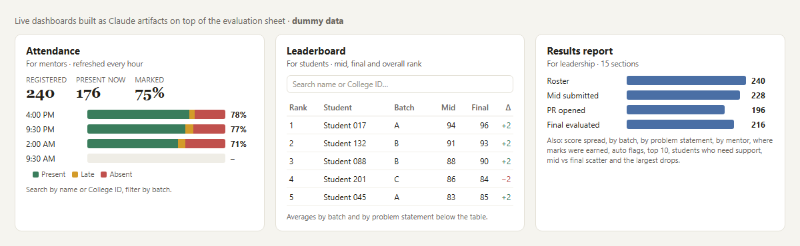

# Open Source Evaluation Automation

A Google Apps Script system that ran a 12-hour, 240-student coding evaluation end to end: it assigned problem statements, built and scheduled the submission form, pulled every student's pull request data from GitHub, and fed an AI-assisted scoring pipeline. Three live dashboards built as Claude artifacts showed attendance, rankings and results to students, mentors and leadership.

*The screenshot uses dummy data. No student names, IDs, contact details or company data are included in this repository.*

## The problem

An internal open source hackathon had about 240 students in three batches, three problem statements and two evaluations (an overnight mid evaluation and an in-person final). Doing this by hand meant splitting students across problem statements, chasing form links, opening every pull request to check tests and CI, and scoring hundreds of submissions in a few hours, all while keeping the process fair.

## The solution

| Step | What the automation does | Manual work left |
| --- | --- | --- |
| Registration | Assigns each new student the problem statement with the fewest students (random tie-break). A re-submission keeps the same problem statement. | None |
| Form | Builds the Google Form from the roster: College ID dropdown, one checklist page per problem statement, branching to the GitHub and progress pages. | One click to set up |
| Window | Opens and closes the form at the times in `Eval Config`. While it is open, a safety net re-syncs responses every 5 minutes. | None |
| Responses | Copies every submission into the score layout. Latest response wins; early and late submissions are marked. | None |
| GitHub | Fetches PR state, changed files, additions, deletions and CI status in batches of 25 requests, and flags edited test files or workflows. | None |
| Scoring | AI-assisted evaluation runs the original tests on each student's latest code and scores code, Markdown files and form answers on a 100-mark rubric. Results fill Auto Marks, Mid Evaluation Scores and the Rank List. | Mentors review flags |
| Final | Mentors enter in-person marks; the Rank List switches to final scores automatically. | Mentor marks |
| Dashboards | Live attendance, leaderboard and results dashboards read from public-safe tabs of the sheet (no phone numbers or emails). Attendance refreshes every hour. | None |

## How it works

## Live dashboards

Three dashboards were built as Claude artifacts on top of the evaluation sheet. Each reads only a public-safe tab, so no phone numbers or emails leave the sheet.

| Dashboard | Audience | What it shows |
| --- | --- | --- |
| Attendance | Mentors | Present, late and absent at each of the 4 checkpoints, attendance % per student and per batch, search by name or College ID. Copied from the sheet every hour. |
| Leaderboard | Students | Overall, mid and final rank, averages by batch and by problem statement, with search and filters. |
| Results report | Leadership | Funnel from roster to final evaluation, score spread, results by batch, problem statement and mentor, where marks were earned, auto flags, top 10, students who need support, mid vs final scatter and the largest drops. |

## Scoring rubric (mid evaluation, 100 marks)

| Parameter | Marks | Evidence |
| --- | --- | --- |
| Codebase Understanding | 15 | Form explanation of the data flow, notes file, `approach.md` |
| Problem Solving | 25 | Root cause in form and PR, fixes against required behaviour, `challenges.md` |
| Working Prototype | 25 | 23 × tests fixed ÷ tests failing at start, + 2 if `python -m main` runs |
| Code Quality | 15 | Focused diff, no hard-coded output, `optimizations.md` |
| Testing | 10 | New regression tests, `TESTING.md` edge cases |
| Demo & Communication | 10 | PR template, clarity of form answers |

## Fairness safeguards

- **Same tests for everyone:** the original repository tests are run on every student's code, so editing or deleting tests cannot raise a score.
- **Flags, not penalties:** edited tests, edited workflows, hard-coded outputs, problem statement mismatches and late submissions are flagged for a mentor to decide.
- **Mentor override:** a mentor's mark replaces the automatic score in the Rank List.
- **Concurrency safe:** `LockService` prevents two submissions from writing at the same time.
- **Token safety:** the GitHub token is stored in Script Properties, never in the sheet.

## Problem statements

| Name | Domain |
| --- | --- |
| OrderOps | Order and refund event processing with idempotency and reconciliation |
| RewardBook | Loyalty points ledger with refunds, caps and repeat-purchase alerts |
| SmartDispatch | Delivery partner assignment by ETA with capacity limits |

The required behaviours for each are in the `PS` object in [src/OpenSourceEvaluation.gs](src/OpenSourceEvaluation.gs).

## Project structure

| File | Purpose |
| --- | --- |
| `src/Code.gs` | Balanced problem statement auto-assignment on registration |
| `src/OpenSourceEvaluation.gs` | Form builder, open/close scheduling, response sync, GitHub fetch, roster sync, menu |
| `src/OpenSourceEvaluationTests.gs` | Test helpers: dummy submissions, burst test, timed window test, status and cleanup |
| `src/appsscript.json` | Apps Script manifest (V8, Asia/Kolkata) |

## Sheet tabs used

| Tab | Role |
| --- | --- |
| Registration Details | Registration form responses + assigned problem statement |
| Attendance Master | Roster (College ID in column B, name in column C, from row 12) |
| Eval Config | Repositories, form window (C10:D10), rubric, form links |
| Pulse Check Responses | Mid evaluation responses (21 columns) |
| GitHub Data | PR state, files, CI status, flags |
| Auto Marks | AI-assisted basis-wise marks, strengths, gaps, flags |
| Mid Evaluation Scores / Final Evaluation | Score tabs in roster order |
| Rank List / Dashboard | Live ranking and overview |

## Setup

1. Add the files from `src/` in **Extensions → Apps Script**.
2. Run `setupTrigger` once (problem statement auto-assignment).
3. Fill the form window in `Eval Config!C10:D10`, then run `setupOpenSourceEvaluation` once.
4. Optional: **Open Source Evaluation Tools → Set GitHub token** (raises the GitHub limit from 60 to 5,000 requests per hour).
5. After the form closes, run **Fetch GitHub data**.

## Testing before the live run

The system was tested end to end before 240 students used it. `src/OpenSourceEvaluationTests.gs` submits real form responses through `FormApp` so every trigger runs exactly as it would live.

| Test | What it proves |
| --- | --- |
| `test1_submitFour` | One response per problem statement reaches Pulse Check Responses in the right columns, with and without a PR link |
| `test2_burst` | 12 back-to-back submissions: the lock and the 5-minute safety net keep every row, none overwritten |
| `test3_scheduleSoon` | The form opens and closes on its own 2 and 4 minutes later |
| `test_status` | Prints form state, response counts and installed triggers |
| `test_cleanupTestOnly` | Deletes only test responses (email starting with `test.`), safe while real students submit |

Set `TEST_STUDENTS` to roll numbers from your own roster first. `test_cleanup` deletes every response, so run it only before the real evaluation.

## Improvements made for this public version

- The 5-minute response safety net now starts automatically when the form opens (before, it only ran once at close).
- Re-running the scheduler after the close time keeps the form closed instead of reopening it.
- The form title, description and closed message are built from `Eval Config`, so students always see the real deadline.
- The registration tab is found by name instead of a hard-coded sheet ID.

## Tech

Google Apps Script (V8), FormApp, SpreadsheetApp, UrlFetchApp with the GitHub REST API, LockService, PropertiesService, time-driven and form-submit triggers, Claude (AI-assisted scoring and live dashboards as artifacts).

## Author

Abhishek Kumar, Revenue Operations & Automation Analyst.
